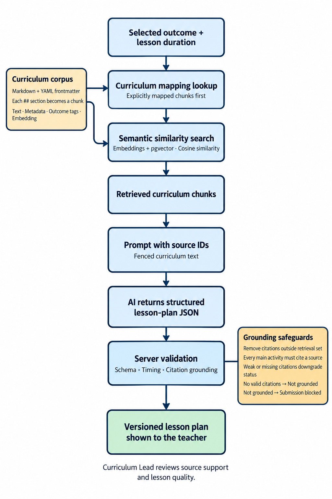
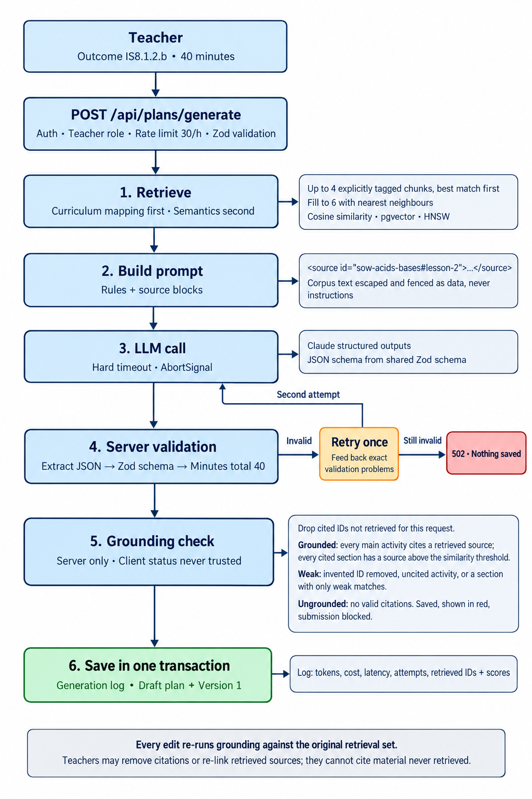
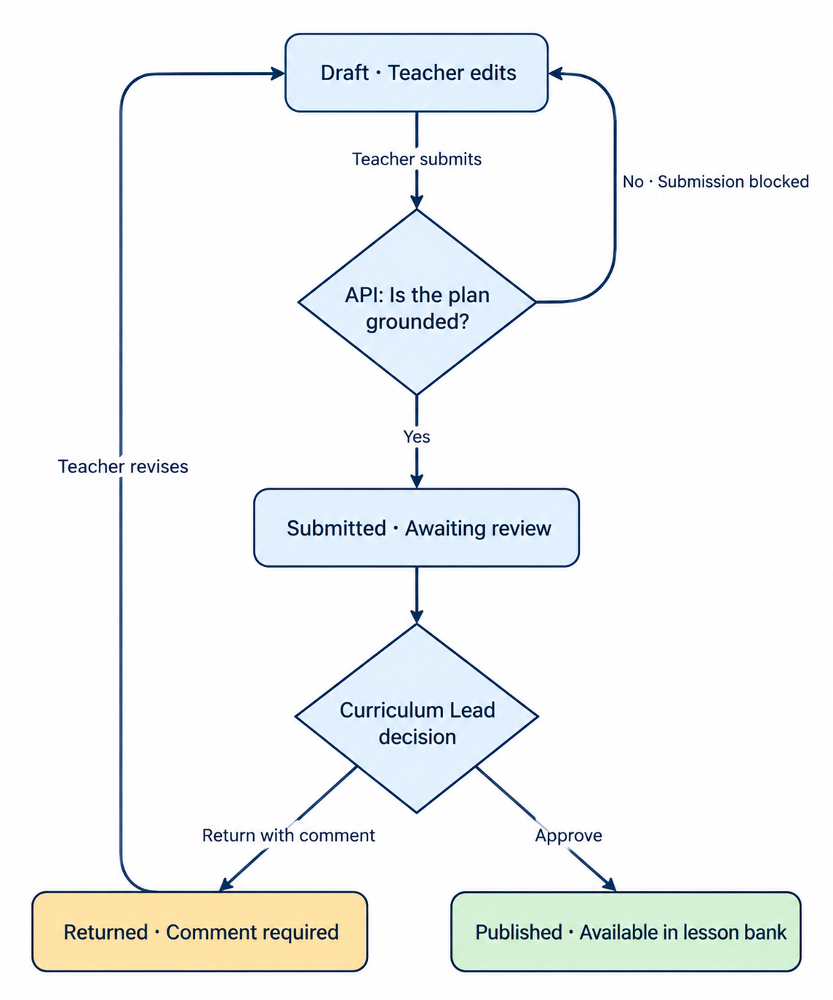

# Curriculum Design Hub

A teacher selects a Grade 5–8 Integrated Science outcome and lesson duration, drafts from retrieved curriculum excerpts, edits the plan, and submits it for review. A Curriculum Lead approves it into the shared lesson bank or returns it with a comment.

**Loom walkthrough:** Pending recording.

## Run locally

### Docker: run everything

With Docker Desktop / Docker Engine and Compose v2 running, execute from the repository root:

```bash
docker compose up --build
```

Open **http://localhost:8080**. No local Node installation, npm commands, `.env` file, or AI key is needed for the default demo. Compose builds the web app, runs PostgreSQL, applies migrations, seeds the curriculum and accounts, and starts the API before exposing the web app. First startup downloads the embedding model and can take a few minutes.

The web container serves the built React app and proxies `/api` to the API container. Database records, model downloads, and the generated signing secret persist in named volumes. This configuration uses local HTTP with development cookie settings; a public deployment needs HTTPS and production cookie settings.

Stop with **Ctrl+C**, or use `docker compose down`. Both retain the volumes. Use `WEB_PORT` to change port 8080. An existing `.env` supplies provider and PostgreSQL settings, but the container constructs its own internal database URL. Rebuild after code changes with the same command.

### Node: develop locally

Install **Node.js 22.12+** (or Node 20.19+) and start **Docker Desktop / Docker Engine with Compose v2**. From the repository root:

```bash
npm ci
npm start
```

Open **http://localhost:5173**. If that port is occupied, use the URL Vite prints.

`npm start` creates `.env` with a random signing secret if needed, starts PostgreSQL and waits for it to be healthy, applies migrations, ingests the curriculum, seeds demo accounts and example plans, and starts the API and web app. Existing `.env` and lesson plans are preserved; unchanged embeddings are reused. Demo account credentials are refreshed to the values below.

The default is **deterministic mock generation**, with no LLM key or paid requests. First setup needs internet to install packages, pull the database image, and download the local MiniLM embedding model. The model is cached in `.cache/models`; later mock runs can use the cached resources.

Default ports: web **5173**, API **4000**, PostgreSQL **5433**. The API and database ports must be available. Stop the app with **Ctrl+C**; the database remains running with its data.

| Command                  | Purpose                                             |
| ------------------------ | --------------------------------------------------- |
| `npm start`              | Prepare the environment and run both apps           |
| `npm run dev`            | Run both apps when the database is already prepared |
| `npm run db:down`        | Stop Compose services, preserving their volumes     |
| `npm run check`          | Lint, formatting, type checks, and automated tests  |
| `npm run eval:retrieval` | Check retrieval with local MiniLM embeddings        |

### Use a real LLM

Set these values in the generated `.env`:

```dotenv
LLM_PROVIDER=anthropic
ANTHROPIC_API_KEY=your-api-key
```

Set `ANTHROPIC_MODEL` to a model enabled for your account that supports the adapter's structured-output options, then restart `npm start`, or rerun `docker compose up --build` for Docker. Model availability and permissions depend on your account. Failure simulation is hidden and rejected by the API in live mode.

The automated suite tests the provider's schema and error handling without paid requests. It does not establish live model availability.

## Demo accounts and walkthrough

All accounts use **`DemoPass!2026`**. Sign-in shortcuts fill the credentials.

| Account        | Email            | Role            |
| -------------- | ---------------- | --------------- |
| Amina Odhiambo | `amina@hub.test` | Teacher         |
| Kevin Mutua    | `kevin@hub.test` | Teacher         |
| Grace Wambui   | `grace@hub.test` | Curriculum Lead |

A new database includes two Kevin examples: a published osmosis lesson and a submitted circuits lesson.

1. **Teacher:** Sign in as Amina, open **My plans**, choose Grade 8, outcome **IS8.2.1.b**, and 40 minutes, then **Draft lesson plan**.
2. **Inspect and edit:** Open a curriculum source. Expand a lesson stage to edit its actions, minutes, or source links. **Preview** shows unsaved edits; **Save version** preserves a new version. **History** opens earlier versions read only.
3. **Validate:** Change activity minutes so the total differs from 40. Saving is blocked. Restore the total, save, and **Submit for review**.
4. **Lead:** Sign in as Grace, open **Review queue**, and inspect the submitted lesson and its sources. **Return with comment** requires feedback; **Approve and publish** adds it to **Lesson bank**.
5. **Revisions:** If returned, Amina can edit, save, and resubmit. Published plans are visible to both teachers.

Use separate browser profiles or a normal and private window to demonstrate both roles without sharing their sign-in cookie.

For a repeatable failure, open **Test generation failures** on the drafting form and choose **Invalid JSON**. Other choices include **Retry after an invalid response**, **Invalid lesson structure**, **Missing citations**, **Invented citations**, **Response timeout**, and **Provider outage**. Reset to **Normal response** afterward.

## Retrieval and grounded generation

1. The selected outcome is embedded locally. PostgreSQL/pgvector retrieves up to **four explicitly outcome-mapped chunks**, then fills to **six** using cosine similarity. Both queries stay within the selected grade.
2. The prompt supplies rules, lesson duration, and retrieved excerpts with source IDs. Source text is escaped and framed as reference data.
3. The provider returns lesson-plan JSON. The Anthropic adapter requests a structured response using a JSON schema derived from shared Zod definitions.
4. The API validates the schema and checks that all activity minutes equal the requested duration. Invalid output gets one repair attempt with the validation problems.
5. The API removes citations outside this request's retrieval set and assesses grounding. A successful generation log, draft, and first version are saved in one transaction.



Grounding checks citation provenance and similarity, not whether every teaching claim is supported. **Grounded** requires citations on all main activities and adequate similarity for each cited section. Missing activity citations, removed source IDs, or weak matches produce **Weakly grounded**. No valid citations produces **Not grounded**, which blocks submission.

Edits repeat validation and grounding against the original generation's retrieved IDs and scores. Teachers can re-link those sources; they cannot introduce arbitrary source IDs.



### Failure handling

| Situation                        | Behaviour                                                                            |
| -------------------------------- | ------------------------------------------------------------------------------------ |
| Invalid JSON, schema, or timings | One repair attempt; if still invalid, return an error, log failure, and save no plan |
| Timeout or provider outage       | Return a clear error, log failure, and save no plan                                  |
| Provider refusal                 | Return a refusal error and save no plan                                              |
| Invented citations               | Remove them and downgrade grounding                                                  |
| No valid citations               | Save a flagged draft; block submission                                               |
| Hourly quota reached             | Reject generation before calling the provider                                        |

Each provider call has an abort timeout (default 90 seconds). The SDK has one transient transport retry; the application repair attempt is specifically for invalid output. Generation records include attempts, tokens, estimated cost, retrieved IDs/scores, and latency measured after retrieval.

## Access and workflow

| Role            | Access                                                                                                           |
| --------------- | ---------------------------------------------------------------------------------------------------------------- |
| Teacher         | Generate, view, edit, and submit their own drafts/returned plans; view published lessons                         |
| Curriculum Lead | Review submitted plans, return with a required comment, approve publication, and view teacher activity summaries |
| Anonymous       | Sign-in only; protected API routes return `401`                                                                  |

Teachers cannot publish or open another teacher's unpublished plans. Leads cannot open private drafts, generate lessons, or edit teacher content. Teacher activity summaries expose aggregate counts, not private draft content. Inaccessible drafts return `404`, and the API reloads the user's role from the database on authenticated requests.



The server enforces **Draft → Submitted → Published**, or **Submitted → Returned → Submitted**. Submitted and published content is read only. Saves check `expectedVersion` under a row lock; stale saves return `409`. Workflow transitions update the plan and audit event transactionally.

## Architecture and data

| Location          | Responsibility                                                                                       |
| ----------------- | ---------------------------------------------------------------------------------------------------- |
| `apps/web`        | React, Vite, and TypeScript interface; forms, lesson editing, review, and shared lesson bank         |
| `apps/api`        | Express and TypeScript; authentication, retrieval, generation, validation, workflow, and persistence |
| `packages/shared` | Zod schemas, API types, and workflow definitions                                                     |
| `corpus`          | Synthetic curriculum Markdown and [format documentation](corpus/README.md)                           |

The separate API keeps secrets and authoritative rules on the server and allows independent testing. Shared contracts reduce drift between the apps. PostgreSQL holds both application data and vectors, keeping this slice to one datastore.

HTTP routes validate requests and call services; services enforce rules; repositories handle queries. Drizzle migrations are in `apps/api/drizzle`.

The data model contains `users`; curriculum `corpus_documents`, `corpus_chunks`, and `learning_outcomes`; `generations`; `lesson_plans`; append-only `lesson_plan_versions`; and `review_events`. Chunks store 384-dimensional embeddings with an HNSW cosine index. Plan versions store structured content and grounding reports as JSONB.

### Corpus and lesson schema

The corpus contains **17 synthetic documents across four types**: learning outcomes, schemes of work, assessments, and a teacher guide. The Grade 8 core contains 11 documents; Grades 5–7 have supplementary examples. This extends the brief's 8–12-document example and does not represent comprehensive curriculum coverage or official Nova Pioneer/KICD material.

YAML frontmatter supplies document metadata. Each `##` heading creates a stable source chunk; `Outcomes:` tags provide explicit mappings. Content hashes and the embedding model allow unchanged documents to be skipped on ingestion.

The server-enforced [lesson schema](packages/shared/src/lessonPlan.ts) defines a title, inquiry question, objectives, materials, core competencies, a starter, 1–5 main activities, and a check for understanding. Activities contain teacher actions, learner actions, minutes, and source IDs; assessment contains questions, minutes, and source IDs. All scheduled minutes must total the requested lesson duration.

## Verification and privacy

`npm run check` covers static checks and automated role isolation, workflow transitions, stale versions, output validation, retry/failure handling, citation grounding, and corpus ingestion. API tests use a separate PostgreSQL test database, created by the Docker initialization script; they reset that test database's schemas. They do not call the paid provider.

`npm run eval:retrieval` checks that outcomes retrieve their own curriculum entry and a mapped lesson. This is a regression check, not a benchmark of semantic relevance or factual accuracy.

Passwords are hashed. Authentication uses an expiring signed JWT in an HTTP-only, SameSite=Strict cookie. Secrets come from environment variables. Embeddings run locally; the LLM receives the outcome, duration, and retrieved excerpts, without teacher identities, edits, or review comments. Plans, versions, reviews, and generation metadata are stored; full prompts and raw model responses are not retained as records.

## Trade-offs and next steps

- **Synchronous generation:** simple to inspect and test. Durable jobs, idempotency, and independently scaled workers would handle longer requests and disconnects.
- **Mapping before similarity:** gives explicit curriculum alignment priority. A larger relevance evaluation should precede reranking or another vector store.
- **Local embeddings and mock mode:** support inexpensive, repeatable review; the mock does not demonstrate a real model's teaching quality.
- **Grounding limits:** provenance checks need human review. Next steps are activity-to-source support evaluation and immutable corpus snapshots.
- **Quota limits:** the database count-then-insert check can admit simultaneous requests; a distributed or atomic reservation would be needed at scale.
- **Scope:** one subject and one school, with supplementary Grade 5–7 examples. Streaming, full offline generation, notifications, restore-to-version, multi-school isolation, and a hosted deployment are outside this slice. Docker Compose runs the complete local demo; Node remains available for development.
